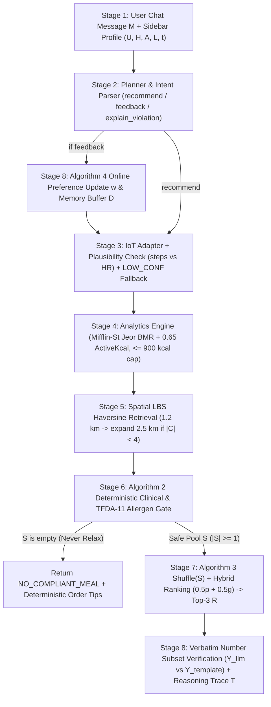

# NutriAgent System Design & Workflow (OpenSpec Design Artifact)

> Converted from `DESIGN.md` v2.0.0 and Proposal Slides 11–21 (Algorithms 1–4).

## Context

**NutriAgent** is a domain-specific conversational AI agent for real-time dining-out decisions that integrates wearable Internet of Things (IoT) activity telemetry, deterministic Medical Nutrition Therapy (MNT) rules, Taiwan TFDA 11 mandatory food allergen regulations, and Google Gemini (`gemini-2.5-flash`). General-purpose LLMs exhibit severe numerical instability on local convenience-store and bento meals (sodium CV 20%–70%) and lack deterministic safety guarantees for chronic kidney disease, hypertension, pre-diabetes, gout, and dyslipidemia. NutriAgent enforces the architectural principle: **"Deterministic rules govern safety and numerical truth; the LLM governs intent understanding and natural language expression."**

## Goals / Non-Goals

**Goals:**
- Achieve **0.0% Clinical Violation Rate (CVR)** and **0.0% Allergen Violation Rate (AVR)** across all synthetic and real-world user evaluations, whether Gemini is online or offline.
- Maintain **100% Verbatim Numerical Grounding** in final conversational responses via post-generation numerical subset verification (`verify_explanation_consistency`).
- Mitigate wearable energy expenditure overestimation ($\text{MAPE} > 30\%$) via cross-sensor plausibility checks, a `0.65` activity damping factor, and a `900 kcal` single-meal cap.
- Eliminate LLM zero-shot positional bias via candidate shuffling (`shuffle(S)`) and hybrid scoring ($q = 0.5p + 0.5g$).
- Support sub-millisecond offline fallback when `GEMINI_API_KEY` is absent or the cloud API times out (`> 12 s`).

**Non-Goals:**
- Generating unconstrained free-form recipes or unverified nutritional estimates via LLM weights.
- Relaxing clinical or allergen hard constraints when local dining options are scarce ($S = \emptyset$).
- Replacing clinical diagnosis or prescription medication management.

## Decisions

### Decision 1: Pre-LLM Deterministic Clinical & TFDA-11 Allergen Gate (Rule-First Safety Gate)
- **Choice**: Place `ClinicalGate(C, H, A)` (Algorithm 2 in `src/clinical_rules.py`) strictly upstream of Gemini semantic scoring and dialogue generation.
- **Rationale**: Multi-objective RL recommenders (e.g., MORL-A2C) treat health as a soft trade-off objective, while model-based guardrails (e.g., FoodGuard-4B) remain probabilistic and susceptible to adversarial prompts. A deterministic Python rule gate is 100% unit-testable, auditable via rejection log $V$, and immune to prompt injection.
- **Zero-Relaxation Policy**: When $S = \emptyset$, return `NO_COMPLIANT_MEAL` + `generate_order_tips(C, H)` rather than relaxing sodium, potassium, sugar, purine, or allergen thresholds.

### Decision 2: Error-Aware Wearable IoT Budgeting with 0.65 Damping & Plausibility Filter
- **Choice**: Compute $\text{TDEE} = \text{MifflinStJeor}(U) + 0.65 \times \text{telemetry.active\_kcal}$ with `budget = min(TDEE * ratio[t], 900)` and reject false step spikes when `steps > 10000` and `HR <= 70 bpm`.
- **Rationale**: Systematic reviews report $>30\%$ MAPE in wrist-worn energy expenditure. A `0.65` damping factor prevents over-eating compensation while preserving dynamic adaptation for genuinely active days.

### Decision 3: De-Biased Hybrid Ranking & Post-Generation Verbatim Number Verification
- **Choice**:
  1. Shuffle safe pool $S$ before requesting Gemini JSON scores ($g \in [0,1]$, `temperature = 0.1`).
  2. Compute hybrid preference $q = 0.5p + 0.5g$ (fallback $q = p$) and total score $\text{Score} = 0.50 \cdot q + 0.35 \cdot \text{NutriFit} - 0.15 \cdot \min(1, \text{distance}/1.5)$.
  3. Generate deterministic baseline reply $Y_{\text{template}}$ first; only adopt Gemini reply $Y_{\text{llm}}$ (`temperature = 0.25`) if `numbers_in(Y_llm) subset_of db_values(R, budget)`.
- **Rationale**: Prevents LLM positional bias during ranking and guarantees that no hallucinated calorie, sodium, protein, price, or distance figure ever reaches the user UI.

### Decision 4: 8-Stage End-to-End Execution Workflow

## Risks / Trade-offs

- **[Risk] Empty Safe Pool in High-Restriction Profiles** (e.g., combined CKD + Hypertension + Multiple Allergens) $\rightarrow$ **Mitigation**: Automatic Haversine expansion from `1.2 km` to `2.5 km` plus actionable modification tips (`generate_order_tips`, such as sauce halving, skin removal, or soup avoidance) when $S = \emptyset$.
- **[Risk] Cloud Transmission of Sensitive Health Metrics** $\rightarrow$ **Mitigation**: Pass only derived clinical constraint flags and pre-filtered safe meals $S$ to the Gemini API, obtain explicit user consent, and transmit the API key via the `x-goog-api-key` HTTP header.
- **[Risk] LLM API Latency Spikes** $\rightarrow$ **Mitigation**: Enforce a hard `12 s` timeout and automatic fallback to the deterministic offline engine ($0.08\text{ ms}$ mean latency).
